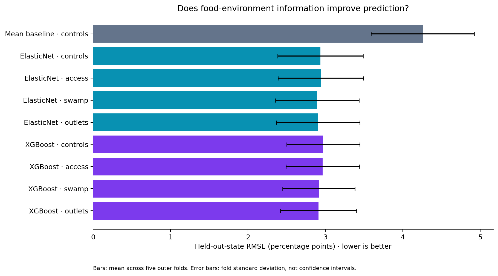
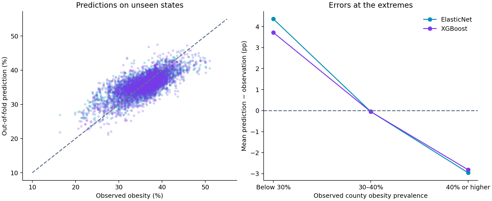

# Obesity and Fresh Food Access
### New Evidence and Solutions From Geospatial Data

**Saswat Tripathi · ISEF-related research · Applied machine learning**

Can local food environments help predict adult obesity beyond socioeconomic conditions? This research combines public data for **3,110 U.S. counties**, evaluates models on **held-out states**, and tests which food-environment features add predictive value.

**Main finding:** a regularized linear model performs about as well as gradient-boosted trees. Food-swamp information adds modest predictive value; limited food access alone adds little in these experiments. Both models struggle with counties at the extremes of obesity prevalence.

[Research walkthrough](notebooks/research_walkthrough.ipynb) · [Methods](docs/methods.md) · [Data](docs/data.md) · [Verified results](results/portfolio/summary.csv)

## Research context

This repository contains **Saswat Tripathi’s research for and continued work on his ISEF project, _“Obesity and Fresh Food Access: New Evidence and Solutions From Geospatial Data.”_** The county-level modeling component investigates the relationship between food access, the balance of healthy and unhealthy food outlets, and adult obesity.

## Machine-learning skills demonstrated

| Skill | Evidence in this repository |
| --- | --- |
| Data integration and feature engineering | Merge CDC, USDA, Census, and BLS data by county FIPS; aggregate tract access measures and construct retail-density ratios |
| Leakage-aware evaluation | Five outer folds hold out entire states; ElasticNet tuning uses three inner state-grouped folds; scaling stays inside the pipeline |
| Experimental design | Compare a training-mean baseline and two model families across four deliberately separated feature sets |
| Model interpretation | Compare feature groups and inspect fold-specific standardized ElasticNet coefficients |
| Error analysis | Examine out-of-fold errors by state, urbanicity, and observed obesity prevalence |
| Reproducibility | Record data hashes, package versions, fold assignments, selected hyperparameters, and every held-out prediction; check data and evaluation contracts in CI |

## Results on unseen states

The table reports **pooled out-of-fold metrics** for the current analysis. Every model uses the same five outer folds. ElasticNet tuning is nested; XGBoost settings are fixed in advance of this run.

| Model / features | RMSE ↓ (pp) | MAE ↓ (pp) | R² ↑ |
| --- | ---: | ---: | ---: |
| Training-mean baseline | 4.298 | 3.277 | −0.019 |
| ElasticNet · socioeconomic + rural–urban controls | 2.976 | 2.294 | 0.512 |
| ElasticNet · controls + access + swamp ratio | **2.935** | **2.270** | **0.525** |
| XGBoost · socioeconomic + rural–urban controls | 3.001 | 2.334 | 0.503 |
| XGBoost · controls + access + swamp ratio | 2.944 | 2.276 | 0.522 |

The lowest observed error is not evidence of a statistically superior model. This comparison suggests that the interpretable linear model is a competitive starting point; it does not rule out better results from other nonlinear specifications.



Unlike the pooled table, the chart shows **mean fold RMSE ± one fold standard deviation**. These bars describe variability across geographic splits, not confidence intervals.

### What do the food features add?

- **Access alone:** pooled RMSE changes from 2.976 to 2.980 for ElasticNet and from 3.001 to 2.996 for XGBoost—little improvement.
- **Access plus swamp ratio:** pooled RMSE improves by about 0.041 pp for ElasticNet and 0.057 pp for XGBoost relative to controls alone. The improvement occurs in four of five folds for ElasticNet and all five for XGBoost.
- **Separate outlet densities:** perform similarly to the composite ratio. Composite and component measures are tested in separate models to avoid redundant predictors.

[All nine experiments](results/portfolio/summary.csv) · [Fold-level paired differences](results/portfolio/paired_deltas.csv)

## Where the models fail



For the access-plus-swamp models, both methods tend to **overpredict low-obesity counties and underpredict high-obesity counties**. ElasticNet’s mean error is +4.36 pp below 30% observed obesity and −2.95 pp at 40% or higher. Its metro and nonmetro RMSEs are similar, at 2.92 and 2.94 pp, but errors vary substantially across states.

These outcome-based groups are retrospective diagnostics, not groups available before observing the outcome. Small state samples and restricted outcome ranges make subgroup R² unstable. The [subgroup results](results/portfolio/subgroup_errors.csv) include sample sizes and error metrics.

## Run it

Python **3.11 or newer**; the completed analysis used Python 3.14.

```bash
python3 -m venv .venv
source .venv/bin/activate
python -m pip install -r requirements.txt
python src/model.py --jobs 1
python -m unittest discover -s tests -v
```

On Windows, activate with `.venv\Scripts\activate`. The default analysis reads the included processed data and writes to `results/generated/`, leaving the published `results/portfolio/` snapshot unchanged. To regenerate the published snapshot, pass `--output-dir results/portfolio`.

The [notebook](notebooks/research_walkthrough.ipynb) is readable on GitHub with saved outputs. To run it interactively, install JupyterLab in the same environment and open it there. It examines the published experiments; the full training command remains in `src/model.py`.

## Repository map

```text
src/model.py                     Nested evaluation, feature comparisons, error analysis
src/build_county_obesity_2019.py  Raw-source integration and feature engineering
data/processed/                  Included county-level dataset
notebooks/                       Research walkthrough with executed outputs
results/portfolio/               Current metrics, predictions, figures, and run manifest
tests/                           Data integrity and evaluation checks
.github/workflows/checks.yml     Automated checks on pushes and pull requests
docs/                            Data provenance, methods, and validation
archive/ + results/reference/    Earlier analysis retained for traceability
```

## Interpretation and next steps

This is an observational county-level study. **Predictive associations do not identify causal effects, individual health risks, or intervention outcomes.** Data vintages differ, some missing outlet values were treated as zero, and geographic dependence can remain across state boundaries. Comparisons informed by this dataset need independent confirmation before stronger generalization claims.

Next steps are an external geographic or temporal validation set, better-aligned source vintages, a county exclusion audit, and uncertainty analysis that accounts for spatial dependence. See [methods and limitations](docs/methods.md).

## Author

**Saswat Tripathi** · [GitHub: TDLPoof](https://github.com/TDLPoof)

*Obesity and Fresh Food Access: New Evidence and Solutions From Geospatial Data.* Public data sources retain their attribution and reuse terms. A software license has not yet been selected.
