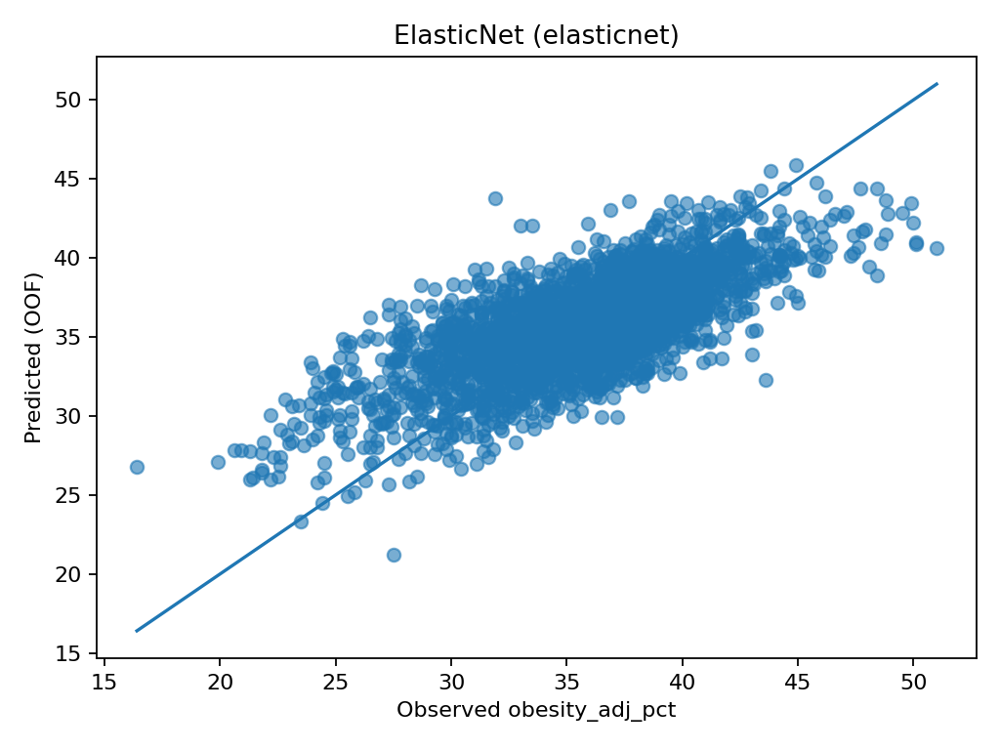
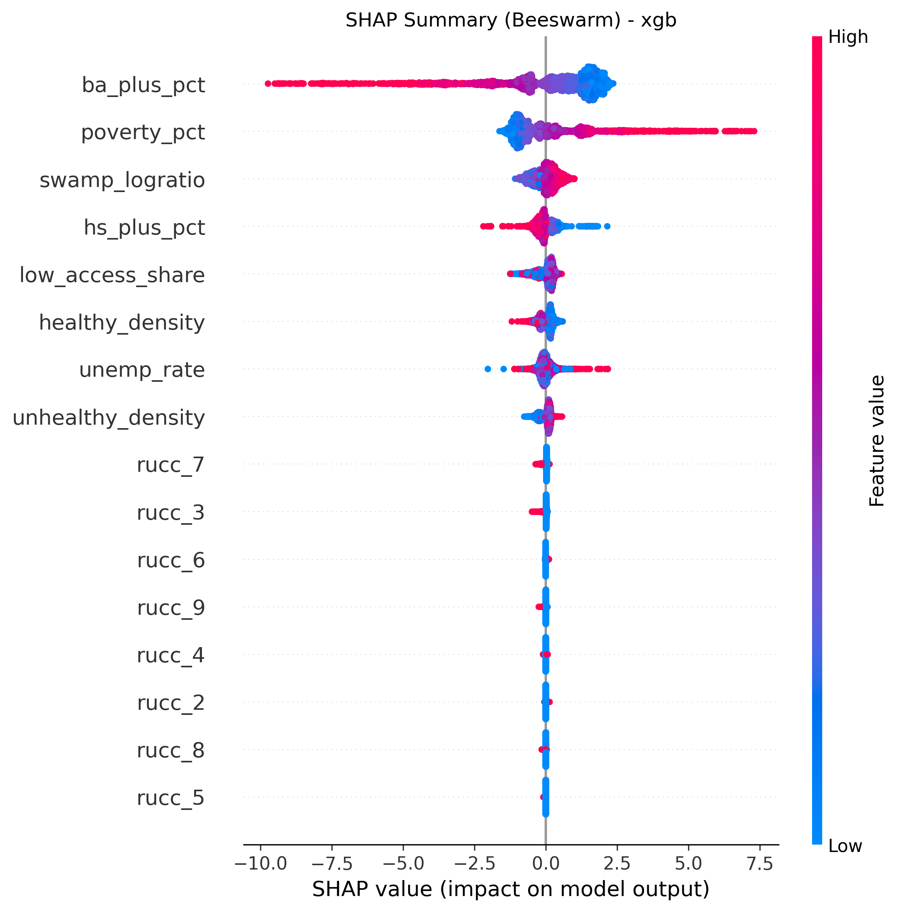

# Obesity and Fresh Food Access

### New Evidence and Solutions From Geospatial Data

**Saswat Tripathi · ISEF-related research**

**Do local food environments help predict adult obesity after accounting for socioeconomic conditions and rural–urban context?** This project combines public data for **3,110 U.S. counties** and compares an interpretable linear model with gradient-boosted trees.

## About this research

This repository contains **Saswat Tripathi’s research for and continued work on his ISEF project, _“Obesity and Fresh Food Access: New Evidence and Solutions From Geospatial Data.”_** It brings together public geospatial and socioeconomic data to investigate how food access and the balance of healthy and unhealthy food outlets relate to adult obesity across U.S. counties.

The analysis combines county-level datasets, constructs food-environment measures, compares machine-learning models, and examines their predictions using state-grouped validation and model interpretation.

## At a glance

| Study element | Approach |
| --- | --- |
| Outcome | 2019 age-adjusted adult obesity prevalence, in percentage points |
| Coverage | 3,110 counties in the supplied cleaned dataset |
| Food environment | Limited food access; healthy and unhealthy outlet densities; food-swamp measures |
| Context | Poverty, educational attainment, unemployment, rural–urban classification |
| Models | ElasticNet and XGBoost |
| Evaluation | Five-fold cross-validation, holding out entire states |

## Results

| Model | RMSE (percentage points) | MAE (percentage points) | R² |
| --- | ---: | ---: | ---: |
| ElasticNet | 2.938 | 2.272 | 0.524 |
| XGBoost | 2.932 | 2.272 | 0.526 |

The verified model results are included in [`results/reference/`](results/reference/). The two models perform similarly. Educational attainment and poverty have the strongest signals in the saved coefficients and tree feature importance. The food-swamp log ratio has a smaller positive association in the linear model; limited food access receives a zero coefficient after regularization.

These findings describe **county-level associations, not causal effects or individual health predictions**. They do not establish that a particular intervention would reduce obesity. See [methods and limitations](docs/methods.md) for evaluation and interpretation details.

### Predictions on held-out states



### How the tree model uses the predictors



The SHAP figure describes a model fitted to the full dataset; it is an interpretation figure, not an independent validation result.

## Run the analysis

Use Python 3.11 or newer. The source environment used Python 3.14; dependency versions are pinned to those recorded there.

```bash
python3 -m venv .venv
source .venv/bin/activate
python -m pip install -r requirements.txt
python src/model.py --data data/processed/county_obesity_2019_model_data.csv
```

On Windows, activate with `.venv\Scripts\activate`. The default run evaluates both models with two food-swamp definitions and writes metrics, coefficients, predictions, and plots to `results/generated/`. Reference artifacts remain separate. CPU use defaults to two jobs; use `--jobs 1` for a serial run. All four default runs were verified against the reference metrics; see the [validation record](docs/validation.md).

The processed dataset is included, so modeling does not require downloading the original sources. To rebuild it, follow the [data guide](docs/data.md).

## Repository guide

```text
src/                     Data preparation and modeling scripts
data/processed/          Cleaned county-level modeling data
docs/data.md             Data sources, variables, provenance, and rebuild instructions
docs/methods.md          Model design and research limitations
results/reference/       Verified reference results and figures
requirements.txt         Recorded Python dependency versions
```

## Scope and next steps

This repository documents the county-level modeling component of the research. Next steps include nested model selection, explicit controls-only comparisons, uncertainty estimates, and validation with aligned data vintages. Details of exploratory analyses and their limitations are recorded in the [methods](docs/methods.md).

## Attribution and reuse

Research by **Saswat Tripathi** ([TDLPoof](https://github.com/TDLPoof)). Please cite this work as: Saswat Tripathi, *Obesity and Fresh Food Access: New Evidence and Solutions From Geospatial Data*. Public data sources retain their respective terms and attribution requirements. No software license has been selected for this repository yet; public availability alone does not grant a reuse license.
